<div align="center">


# Pilunia

**Deine Medikamente. Liebevoll im Blick.**

Eine Android-App, die dich pünktlich an deine Tabletten erinnert und jede Tablette im Blister mitzählt –
damit du rechtzeitig weißt, wann eine neue Packung fällig ist.


<br />

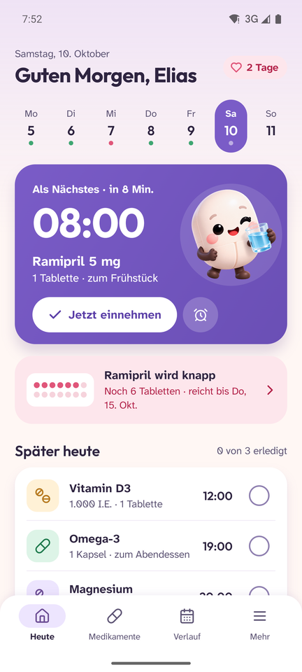&nbsp;&nbsp;
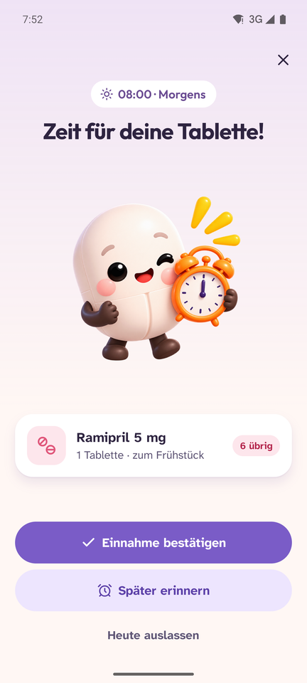&nbsp;&nbsp;
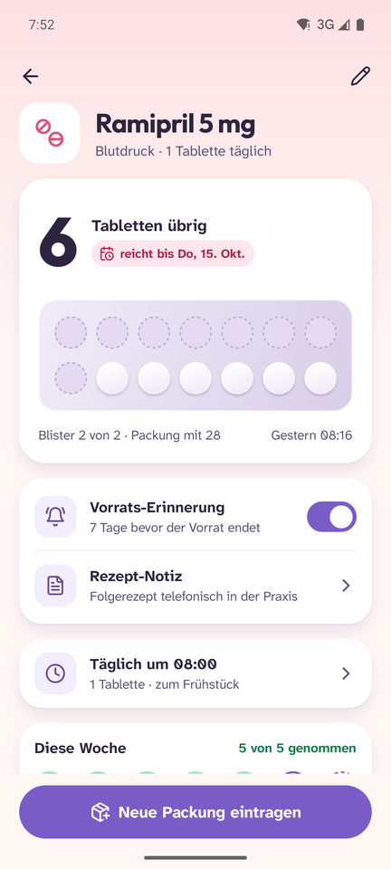

</div>

---

Die Website liegt in [`website/`](website/). Hinweise zur lokalen Vorschau und
Veröffentlichung auf GitHub Pages stehen in der [Website-Anleitung](docs/website.md).

## Was Pilunia kann

| | |
|---|---|
| ⏰ **Erinnert auf die Minute** | Exakte Wecker, auch im Ruhemodus. Die Erinnerung erscheint als Vollbild über dem Sperrbildschirm – mit „Eingenommen“, „Später erinnern“ und „Heute auslassen“. Unbestätigte Einnahmen werden erneut gemeldet. |
| 💊 **Zählt deinen Vorrat** | Jede Einnahme wird vom Blister abgezogen. Pilunia zeigt, wie lange der Vorrat reicht, und warnt rechtzeitig vor dem Ende – mit Rezept-Notiz und „Neue Packung eintragen“. |
| 📅 **Flexible Pläne** | Täglich, an bestimmten Wochentagen oder bei Bedarf. Mehrere Uhrzeiten pro Tag, Einnahmepausen wie 21 + 7 oder ein eigener Rhythmus. |
| 📈 **Verlauf & Statistik** | Kalender mit genommenen und verpassten Tagen, Einnahmetreue, Serien und eine Auswertung je Medikament. Verpasste Einnahmen lassen sich nachtragen. |
| 🩺 **Für den Arzttermin** | Einnahmeplan und Verlauf als PDF teilen, kompletter Verlauf als CSV. |
| 🔒 **Privat** | Kein Konto, keine Cloud. Alle Daten bleiben auf dem Handy; Backup und Wiederherstellung über eine Datei. |
| 🌙 **Hell & dunkel** | Folgt dem System oder fest eingestellt, dazu eine Option für größere Schrift. |

## Screens

### Willkommen

<p>
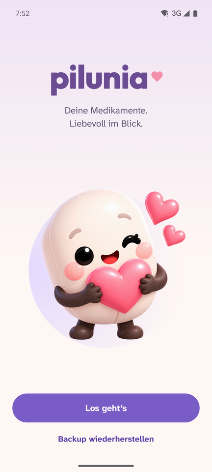&nbsp;
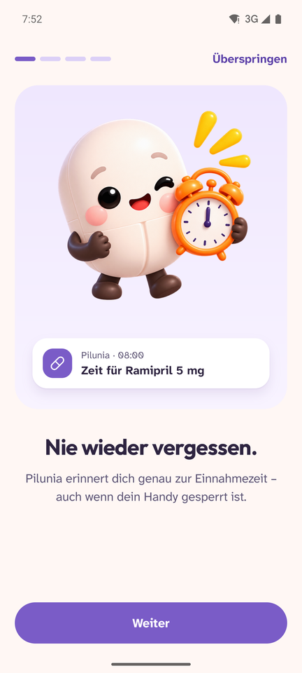&nbsp;
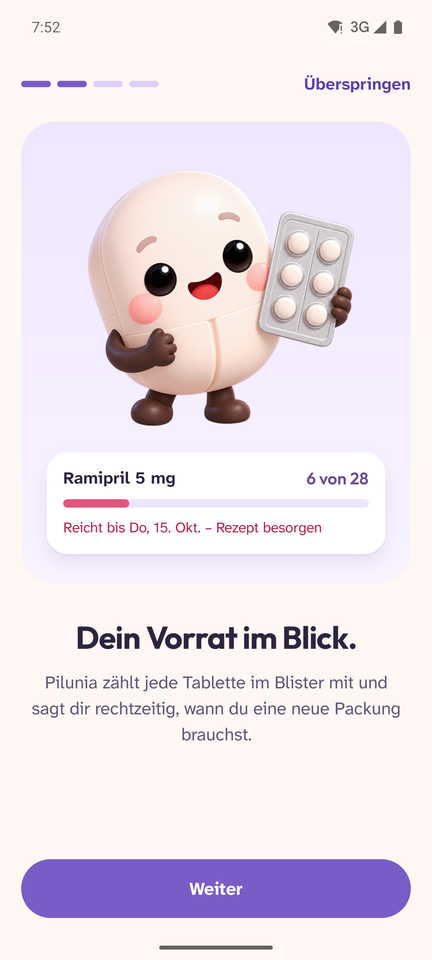
</p>

### Alltag

<p>
&nbsp;
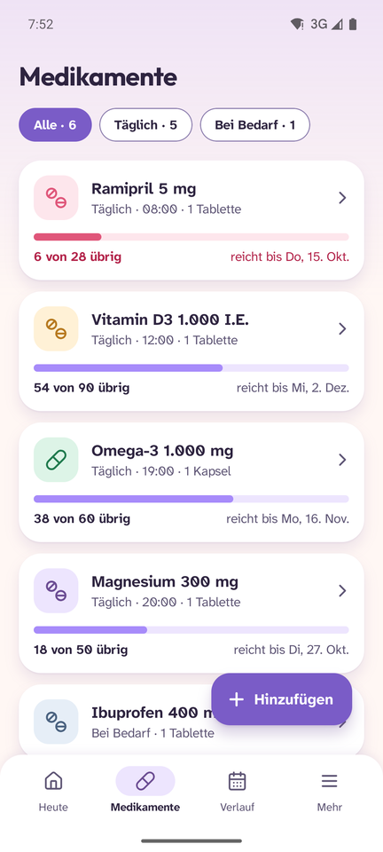&nbsp;
&nbsp;
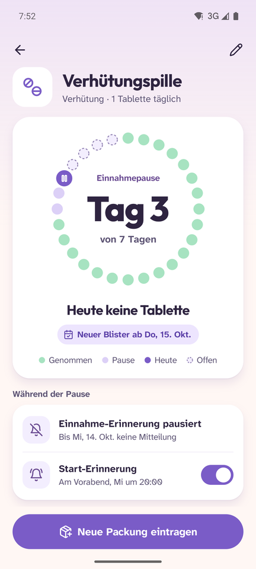
</p>

### Erinnerung

<p>
&nbsp;
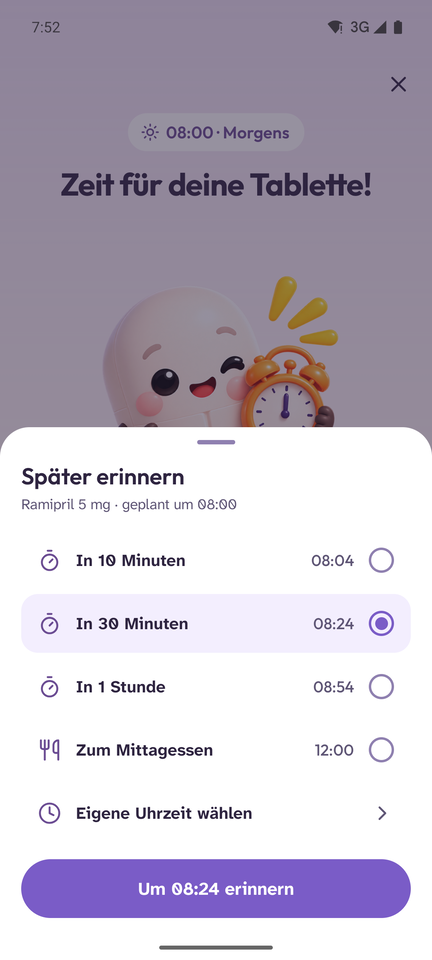&nbsp;
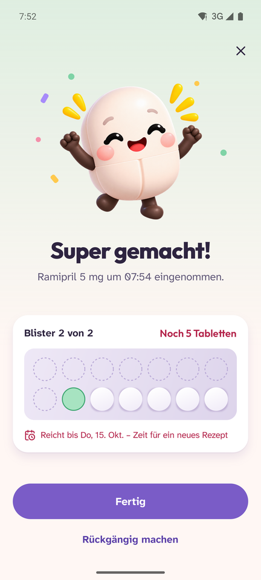
</p>

### Medikament anlegen

<p>
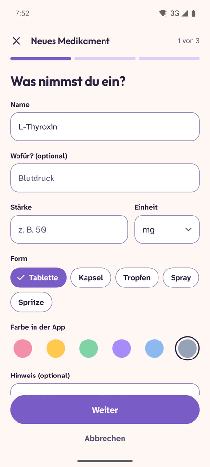&nbsp;
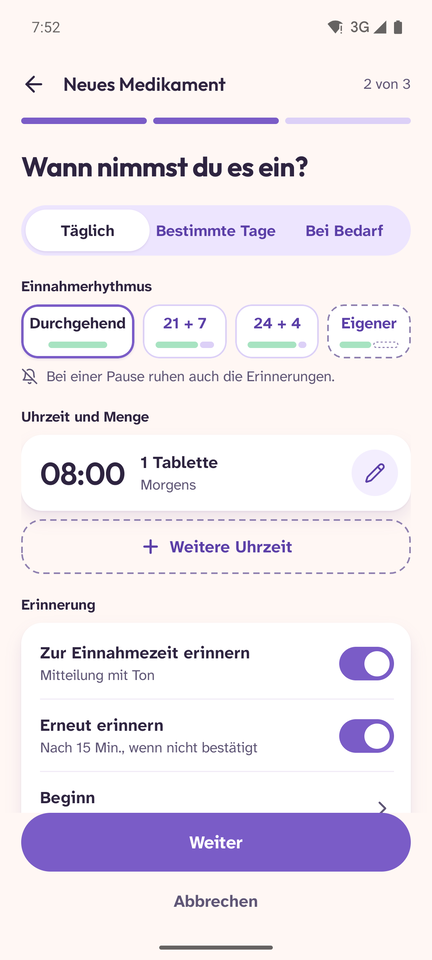
</p>

### Verlauf & Mehr

<p>
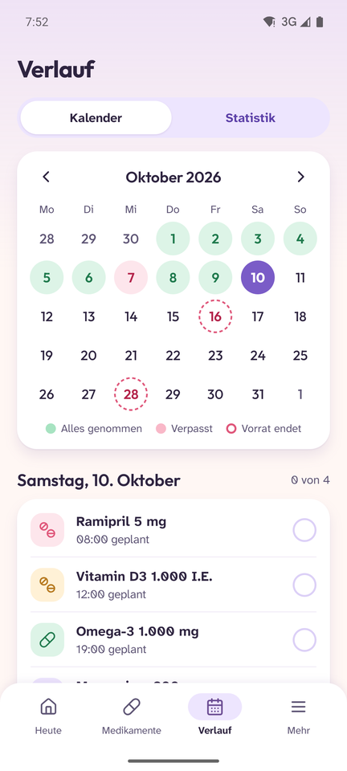&nbsp;
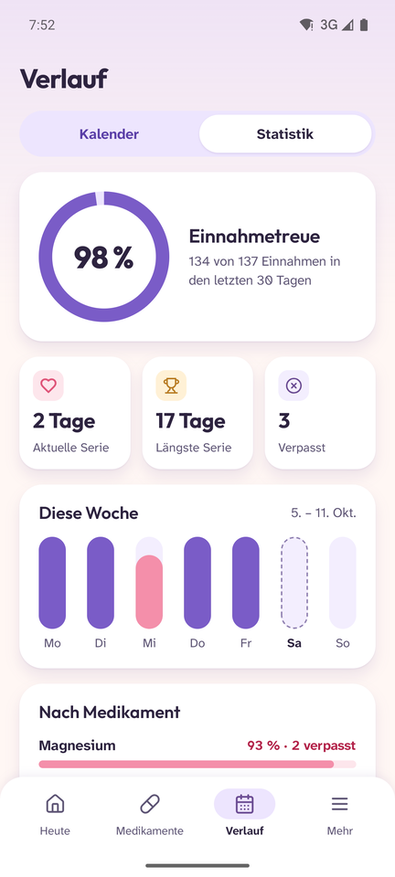&nbsp;
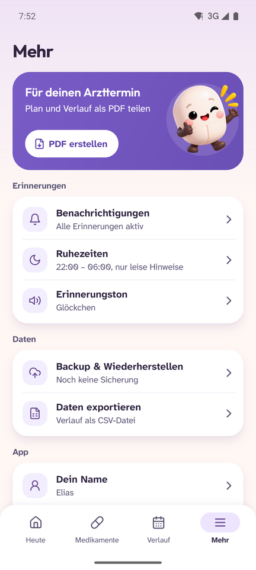
</p>

### Dunkelmodus

<p>
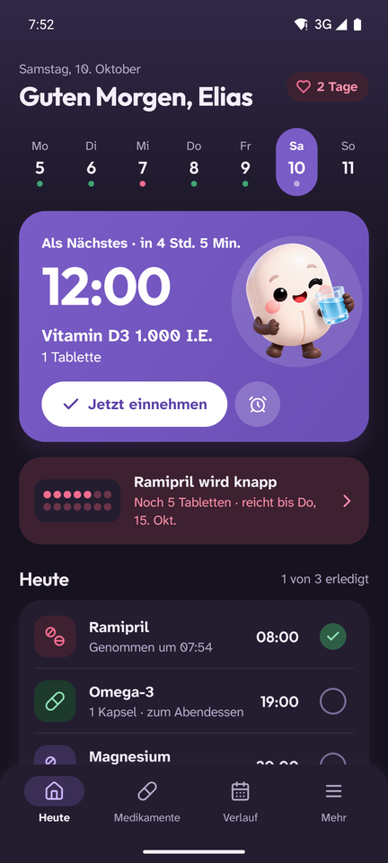&nbsp;
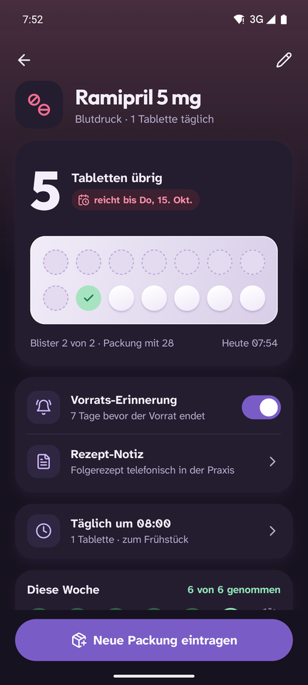&nbsp;
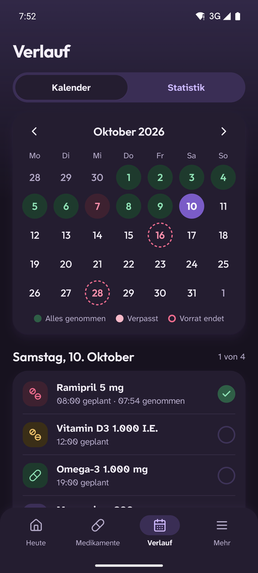
</p>

## Installieren

Die APK gibt es unter [Releases](https://github.com/sirkyomi/Pilunia/releases). Auf dem Handy herunterladen, antippen und die Installation aus dieser Quelle erlauben.

Beim ersten Start fragt Pilunia nach drei Freigaben, damit Erinnerungen zuverlässig ankommen:

- **Mitteilungen** – für die Erinnerung selbst
- **Wecker & Erinnerungen** – für Erinnerungen auf die Minute genau
- **Akku-Optimierung aus** – damit Android keine Erinnerung zurückhält

## Selbst bauen

Voraussetzungen: JDK 17 und das Android SDK (Plattform 35).

```bash
git clone https://github.com/sirkyomi/Pilunia.git
cd Pilunia
./gradlew assembleRelease
```

Die APK liegt danach unter `app/build/outputs/apk/release/`.

<details>
<summary><b>Testdaten im Debug-Build</b></summary>

Der Debug-Build enthält einen Empfänger, der Beispieldaten wie in den Designs einspielt:

```bash
adb shell am broadcast -a de.pilunia.app.DEBUG_SEED -n de.pilunia.app/.DebugSeedReceiver --es name Elias
```

Mit `--ei soon 2` wird stattdessen ein Testmedikament angelegt, das in zwei Minuten fällig ist – praktisch, um Wecker und Vollbild-Erinnerung zu prüfen.

</details>

## Technik

| Bereich | Umsetzung |
|---|---|
| UI | Kotlin, Jetpack Compose, Material 3 |
| Daten | Room (Medikamente, Uhrzeiten, Einnahmen), DataStore (Einstellungen) |
| Erinnerungen | `AlarmManager` mit exakten Weckern, Full-Screen-Intent, Neuplanung nach Neustart und Zeitänderung |
| Export | `PdfDocument` für den Arztbericht, CSV (UTF-8, Semikolon), Backup als JSON |
| Schriften | Outfit (Titel, Zahlen) und Atkinson Hyperlegible Next (Text) |
| Symbole | [Lucide](https://lucide.dev) |

```
app/src/main/java/de/pilunia/app/
├── data/        Room-Datenbank, Repository, Einstellungen, Backup
├── domain/      Zeitpläne, Zyklen, Vorratsprognose, Statistik
├── reminder/    Wecker, Mitteilungen, Vollbild-Erinnerung, Freigaben
├── export/      PDF-Bericht und CSV-Export
└── ui/          Screens (heute, meds, reminder, history, more, onboarding) und Bausteine
```

## Design

Alle Screens stammen aus [`Pilunia.leinwand`](Pilunia.leinwand) – mit Designsystem, Farbvariablen für hell und dunkel und allen Zuständen. Die Figur Pilunia gibt es in 24 Posen unter [`docs/char`](docs/char).

## Lizenzen

- Schriften [Outfit](https://github.com/google/fonts/tree/main/ofl/outfit) und [Atkinson Hyperlegible Next](https://github.com/google/fonts/tree/main/ofl/atkinsonhyperlegiblenext): SIL Open Font License 1.1
- [Lucide Icons](https://lucide.dev): ISC-Lizenz

---

<div align="center">
<sub>Pilunia ersetzt keine ärztliche Beratung.</sub>
</div>
